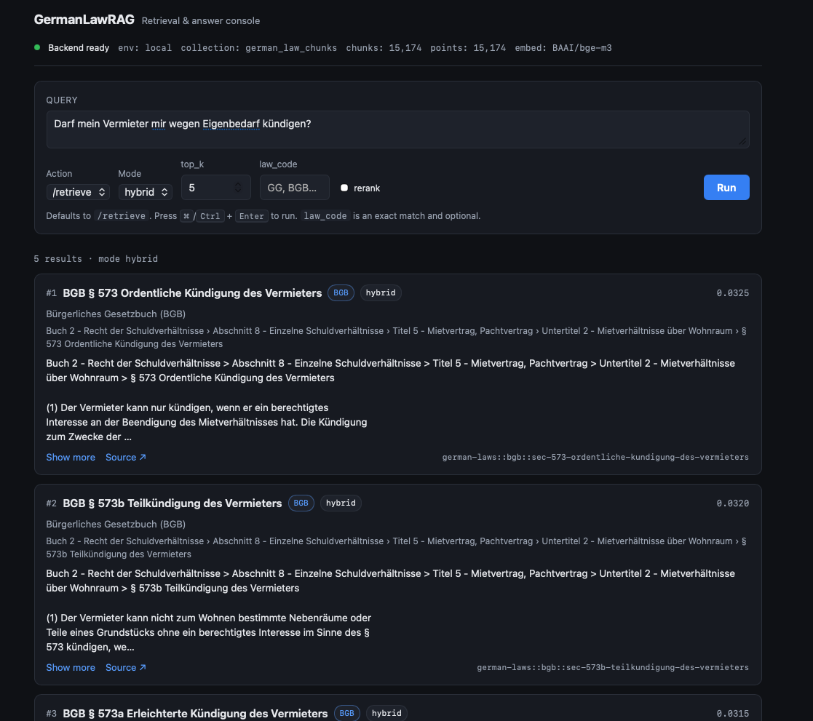

# GermanLawRAG

Hybrid search and cited, grounded answers over German federal law, with an
evaluation suite for both retrieval and answers.

```
ingest → chunk → BM25 + Qdrant → RRF → rerank → grounded answer → citation check
```

- **Ingest and chunk:** Markdown laws from [bundestag/gesetze](https://github.com/bundestag/gesetze)
  are split along their own headings (§ / Art.), so a chunk is usually one section.
  Each chunk keeps its law code, heading hierarchy, and source URL.
- **Retrieve:** BM25 (with German umlaut folding) and dense vectors in Qdrant
  (`BAAI/bge-m3`) run side by side and are merged with reciprocal rank fusion.
  Explicit references such as `§ 242 StGB` are ranked first; this boost can be
  turned off with `EXACT_REFERENCE_BOOST=false`. You can filter by law code.
- **Rerank (optional):** a cross-encoder (`BAAI/bge-reranker-v2-m3`) rescores
  the candidates.
- **Answer:** an OpenAI-compatible chat model answers only from the retrieved
  chunks and cites their IDs. Answers that cite unknown chunks, or cite nothing
  without the `[NO_ANSWER]` refusal marker, are rejected.

## Evaluation

Retrieval on the golden set, top-k = 5 ([full report](eval/results/latest.md)):

| Config | Hit@5 | Precision@5 | MRR@5 |
|---|---:|---:|---:|
| BM25 | 0.886 | 0.177 | 0.777 |
| Dense | 0.977 | 0.195 | 0.883 |
| Hybrid (RRF) | **1.000** | **0.200** | **0.920** |

Run `20260730T221110Z`, on the original 44 questions with the exact-reference
boost on. That report did not record the index scope. Most of these questions
have one relevant chunk, so precision@5 cannot exceed 0.2.

<!-- TODO: after `make eval`, add the results for the expanded 96-question set:
     recall@5 and nDCG@10, boost on vs. off, and the index scope from the report. -->
<!-- TODO: after `make answer-eval JUDGE=1`, add abstention accuracy, claim citation
     coverage, and the mean judge score. -->

The golden set now has 96 questions, including colloquial wording, answers that
span several sections, and unanswerable questions. The answer eval checks that
every claim is cited and that unanswerable questions are refused. See
[eval/README.md](eval/README.md) for details.

## Screenshot

<!-- TODO: save a screenshot of the console as docs/screenshot.png and replace this
     comment with:  -->

## Setup

You need Python 3.12, uv, Docker Compose, and Node.js 20 or newer.
From the repository root:

```bash
uv sync --extra dev --locked
npm ci --prefix frontend
cp .env.example .env
git clone --depth 1 https://github.com/bundestag/gesetze.git data/raw/german-laws
make chunks
make up
make index
```

The first index build downloads the embedding model. By default it indexes 30
selected laws; `make index-all` includes the full corpus. Both rebuild the index.

Start the backend and frontend in separate terminals:

```bash
make dev
```

```bash
npm run dev --prefix frontend
```

Open `http://localhost:5173`. The API documentation is at `http://localhost:8000/docs`.
For answers, configure `MODEL_NAME`, `MODEL_BASE_URL`, and `MODEL_API_KEY` in `.env`
with an OpenAI-compatible chat endpoint. Search works without a chat model.

| Command | What it does |
|---|---|
| `make verify` | Tests, Ruff, mypy, and the frontend build |
| `make eval` | Retrieval eval, with the boost on and off |
| `make answer-eval` | Answer eval; add `JUDGE=1` for the LLM judge |

Python, FastAPI, sentence-transformers, Qdrant, and rank-bm25 power the backend;
React, TypeScript, and Vite power the frontend.

This is a learning project, not a legal advice service. Citation checks confirm
that cited chunks were retrieved; they do not prove that every claim is correct.
